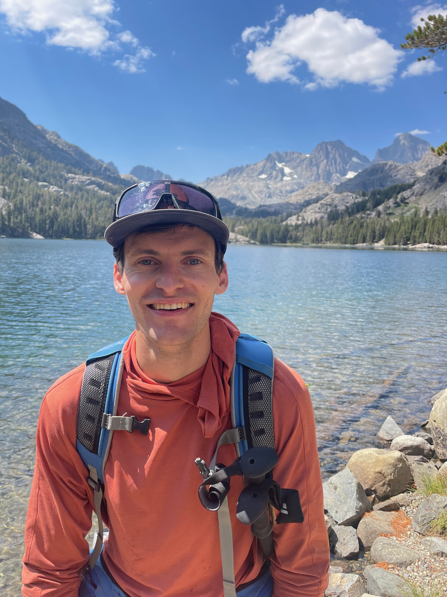

<!-- Intro Section Wrapper (matches your Research section alignment) -->

  

    
    

      
I am PhD candidate in the Agricultural and Resource Economics Department at UC Davis. I am an economist working in agricultural, environmental, and applied econometrics. 

    
 My job market paper focuses on the estimation and projection of land use responses to climate change. My other research studies methods for empirically measuring adaptation, financial exposure to climate risk, and health externalities associated with pesticide use.

      
<strong>I am on the 2026-27 job market.</strong> You can find my <a href="https://scholar.google.com/citations?user=lvBFBcEAAAAJ&hl=en&authuser=1&oi=ao" target="_blank" rel="noopener noreferrer">Google Scholar page here </a>.  

    

  

<!-- Research Section wrapper (aligned with main content, no weird left shift) -->

  
  <!-- Inner container to keep your text/images neatly aligned -->
  

    <section class="section-light">
    

    <h2>Research in Progress</h2>

    

    

    

      

        <strong>{{ paper.title }}</strong>
        
          — <a href="{{ paper.paperurl }}" target="_blank">[link]</a>
        
        
           {{ paper.authors }}
        
      

      

      
        

          {{ paper.content }}
        

      

      
        
      

      

    

    

    

    </section>

    <section class="section-white">
    

    <h2>Publications</h2>

    

    

    

      

        <strong>{{ paper.title }}</strong>
        
          — <a href="{{ paper.paperurl }}" target="_blank">[link]</a>
        
        
           <em style="font-size: 0.95em; font-weight: normal;">{{ paper.venue }}</em>
        
        
           {{ paper.authors }}
        
      

      

      
        

          {{ paper.content }}
        

      

      

    

    

     
    <h2>Education</h2>

    <ul>
    <li>PhD, University of California, Davis (Expected 2027) </li>
    <li>MSc, University of Guelph, 2021 </li>
    <li>BSc, University of Waterloo, 2019 </li>
    </ul>

    

    </section>

  
 

