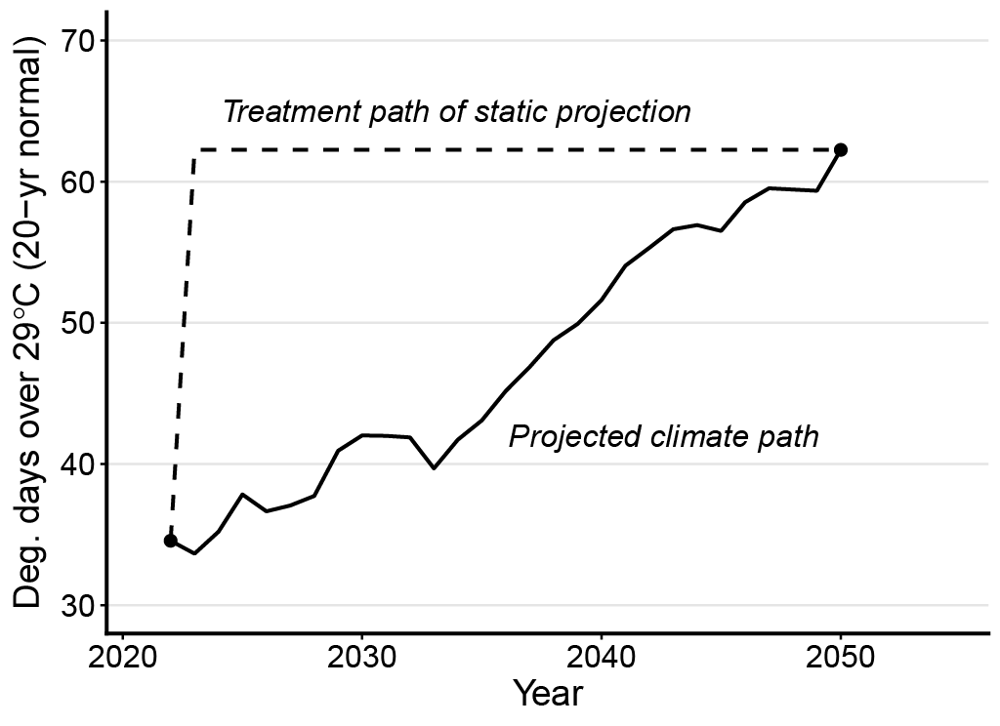
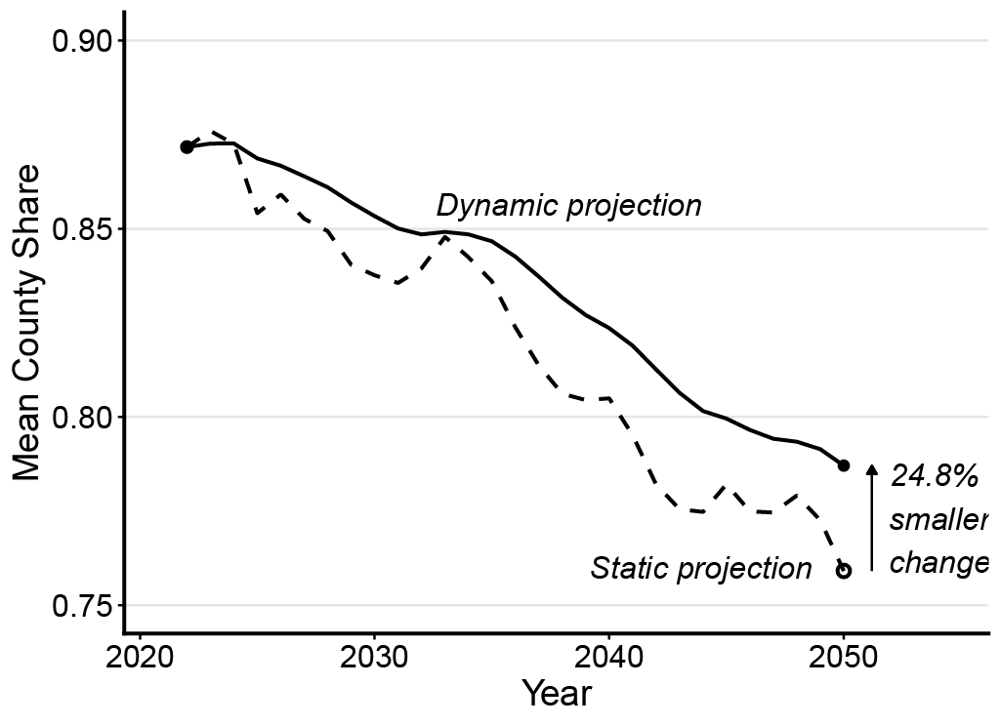
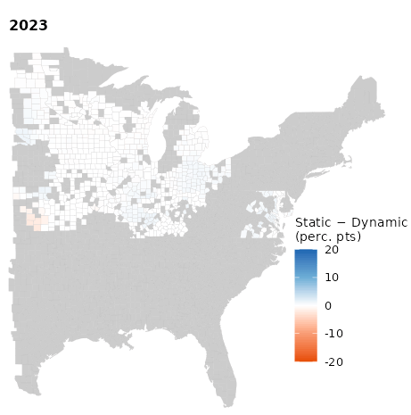
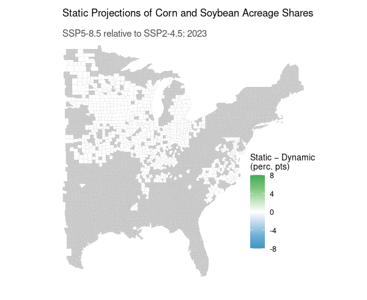
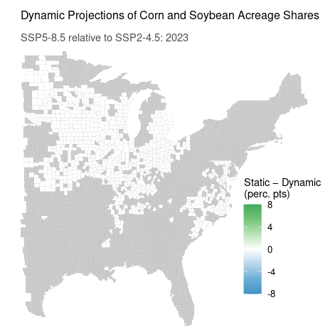

<!-- Top Section: Abstract (60%) + 2 Vertically Stacked Figures (40%) -->

  

    
 
      Projections of the potential impacts of climate change on agricultural systems are crucial for developing climate policy. Yet projections of crop reallocation often rely on static models that assume immediate adjustment. When outcomes are persistent, adjustments in response to climate change may be gradual rather than immediate. Using a dynamic panel model of county-level corn and soybean acreage in the United States, I find considerable persistence in crop acreage allocations. This persistence implies partial adjustment, where acreage responds to climate change incrementally. In contrast to static projections, dynamic projections of future acreage allocations require accounting for the cumulative effect of acreage adjustments along the full climate transition path. I show that compared to dynamic projections, static models overestimate the magnitude of 2050 acreage reductions by 21.6--28.0\% across CMIP6 scenarios relative to a no-climate-change baseline.
    

  

 <!--  

    
    
  
 -->
  

    
    <figcaption style="font-size: 0.85em; color: #555; margin-top: 0.5rem; text-align: center; line-height: 1.4;">
        <strong>Figure:</strong> Static model overprojection of corn and soybean county acreage shares compared to dynamic model projections under SSP2-4.5 (2023–2050) where both projections are relative to a no-climate-change baseline.
      </figcaption>
  

<!-- Bottom Section: 3 GIFs side-by-side (33% each) -->
<!-- 

  

    
  

  

    
  

 -->
